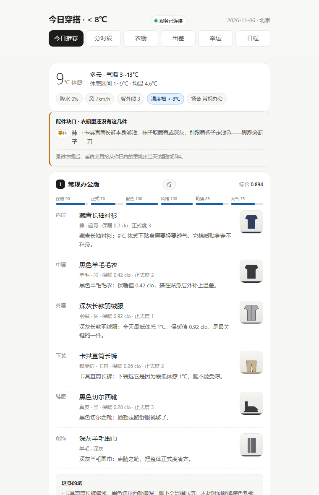

<div align="center">

# dressmate

**Snap your wardrobe, get outfit suggestions for the weather and the occasion.**

19 explainable rules instead of an LLM: zero token cost, works offline, and every suggestion
tells you *why*.

[English](README.md) · [简体中文](README.zh-CN.md) · [Contributing](CONTRIBUTING.md)

</div>

---

<div align="center">



</div>

---

## How this differs from other outfit apps

Most outfit tools work like this: take a photo → hand it to an LLM → get a paragraph back.
dressmate works the other way around:

**Every suggestion comes from a rule you can look up, change, and argue with.**

| | LLM approach | dressmate |
|---|---|---|
| What one outfit costs | Burns tokens on every call | Zero |
| Works offline? | No | Yes |
| Why it picked that piece | Whatever reason the model invented | Points at a specific rule and a specific item |
| Can you change the rules? | No | Change one number, it applies everywhere |
| Does swapping models change the result? | Yes | No |

The core is 12 style penalties (`engine/styling.py`) plus 7 accessory checks
(`engine/extras.py`), on top of temperature curves, formality tiers, and colour harmony:

```python
PENALTY = {
    "three_colors": 0.32,           # more than three colour families in one outfit
    "shoe_jump": 0.20,              # shoes jump to their own colour
    "sneaker_dress_pants": 0.45,    # sneakers with dress pants
    "sneaker_tailored_outer": 0.35, # sneakers with a coat or blazer
    "shoe_drops_tier": 0.28,        # shoes drag the whole outfit down a tier
    "outer_drops_tier": 0.20,       # outer layer drags it down
    "tone_up_dark": 0.08,           # dark on top, light on bottom, in formal settings
    # ...
}
```

The other 7 accessory checks (`engine/extras.py`) cover the details outside the core outfit:

```python
# belt_mismatch   belt doesn't match the shoes
# sock_contrast   light socks with dark dress pants
# tie_clash       tie clashes with the shirt
# bag_jump        bag colour doesn't fit the rest
# skirt_short     skirt length doesn't suit the occasion
# hosiery_gap     wrong hosiery shade under a formal dress
# sheer_bottom    see-through bottom
```

They never enter the candidate pool — a belt only goes with the shoes, socks only with
the pants, the tie is decided by the shirt and outer layer. Searching variables with no
freedom of choice is a waste of time. What stylists actually do is settle the core first,
then close the accessories around it. So this layer does two things: **infer** what should
go with it, and **verify** whether what you picked is right.

Style score enters the total as a **multiplicative** weight (`score *= 1 - 0.40 * (1 - style)`).
This detail matters: with an additive penalty, "sneakers with dress pants" was worth only
0.03 points and got buried by warmth details. Multiplicative, it actually holds the line.

## Quick start

### Docker (recommended)

```bash
docker compose up -d
# open http://localhost:8848
```

On first start it seeds a **fictional 31-piece sample wardrobe**, so you immediately see what
the recommendations look like. To swap in your own clothes, delete them in the web UI and
upload photos.

### Run it locally

Zero third-party dependencies — Python 3.9+ is enough:

```bash
python server.py
# open http://127.0.0.1:8848
```

On Windows you can also double-click `一键启动.bat`.

## What it does

- **Build a wardrobe from photos** — upload a photo and AI works out category, colour,
  material, and warmth value. Without AI configured, import in bulk using Chinese filenames
  (`藏青长袖衬衫.jpg` → base layer / shirt / navy / clo 0.20 / formality 3)
- **Recommend by weather** — 323 prefecture-level cities in an offline coordinate table,
  weather from Open-Meteo; when the network is down it interpolates from the monthly mean
  temperatures of 35 reference cities (3.4 °C average error)
- **Recommend by occasion** — commute / formal / casual / sport / at-home, each with its own
  formality target
- **Split the day into segments** — meeting in the morning, client in the afternoon, gym in
  the evening: three sets, three outfits
- **Pack for a trip** — pick a date range, get the weather along the way and how many pieces
  to bring
- **Grade accessories** — a missing belt and missing glasses are not the same thing: the
  former means the outfit doesn't work, the latter just means one less layer of polish
- **Name the actual problem** — not "you look great today", but "khaki pants with black
  Chelsea boots will look heavy at the ankle; switch to the brown pair"

## Project layout

```
engine/          the rules engine (the core)
  styling.py     12 style rules and their penalty weights
  recommend.py   candidate generation, scoring, three-distinct-outfit selection
  extras.py      accessory grading and gap detection
  city.py        offline city table + online fallback
  weather.py     weather and apparent temperature (climate-table fallback when offline)
  context.py     occasion detection
  timeline.py    day segmentation
  paths.py       runtime paths (relocatable to a volume in containers)
server.py        HTTP service and API
web/index.html   single-file frontend
samples/         public sample wardrobe (fictional)
tools/           import, validation, and release-check scripts
tests/           286 tests
```

## Configuration

Every setting has a sensible default. It runs with no configuration at all.

| Environment variable | What it does | Default |
|---|---|---|
| `DRESSMATE_DATA_DIR` | State directory (wardrobe / city table / schedule / logs) | `./data` |
| `DRESSMATE_PHOTO_DIR` | Photo directory | `./wardrobe/photos` |
| `DRESSMATE_WARDROBE_PATH` | Wardrobe JSON | `./wardrobe/wardrobe.json` |
| `DRESSMATE_AI_BASE_URL` | OpenAI-compatible endpoint | none (AI disabled) |
| `DRESSMATE_AI_API_KEY` | Key for that endpoint | none |
| `DRESSMATE_AI_MODEL` | Vision model name | `gpt-4o-mini` |
| `DRESSMATE_TOKEN` | Token required for write operations | none (off by default) |
| `DRESSMATE_ALLOWED_ORIGINS` | Extra allowed origins, comma-separated | none |
| `PORT` | Listening port | `8848` |

**Plug in your own vision model** (Ollama / vLLM / any OpenAI-compatible service):

```yaml
environment:
  DRESSMATE_AI_BASE_URL: http://host.docker.internal:11434/v1
  DRESSMATE_AI_MODEL: qwen2.5vl
```

Not configuring AI doesn't affect anything else — enter items by hand, or import them in
bulk by filename.

## Privacy

Photos and wardrobe data **stay on your own machine, in your own volume**. There are exactly
three paths where data leaves it, and all three are listed here:

| When | What leaves | Where it goes |
|---|---|---|
| Every recommendation | Your coordinates | Open-Meteo (free weather API) — no identifying info |
| Using "photo auto-detect" | **The photo itself** | The vision model endpoint you configured |
| Filling in `cloud-config.local.js` | **The photo itself** | The cloud service named in that file |

- **Nothing is sent by default.** `web/cloud-config.js` in the repo is an empty template.
- Prefer environment variables for your own model (see the config table above) — the key
  never leaves your machine.
- If you fill in `data/cloud-config.local.js` (WorkBuddy cloud), photos go there. That file
  is **not** committed to the repo, and **not** reachable over HTTP (private files under
  `web/` always return 404).
- The Ziwei Dou Shu "lucky outfit" feature is optional, needs Node.js, and is off by default.
- `docker compose` binds to `127.0.0.1` only, so other devices on your LAN cannot reach it.

## Security

This service stores private data, so it ships with two protections — **both on by default,
nothing to configure**.

### CSRF protection (always active)

Cross-site POST requests are rejected: the check compares `Origin` (or `Referer`) against
`Host`. So while you have the wardrobe page open, another tab can't silently modify your data.

Command-line calls (`curl`, scripts) send neither header and are still allowed, so you can
script against your own service.

Behind a reverse proxy the `Host` is the proxy while `Origin` is your real domain, so they
won't match. Allowlist it:

```bash
DRESSMATE_ALLOWED_ORIGINS=https://your.domain docker compose up -d
```

### Access token (optional)

Set `DRESSMATE_TOKEN` and every write operation (adding, editing, deleting wardrobe items,
changing the schedule) must carry that token:

```bash
DRESSMATE_TOKEN=yourpassword docker compose up -d
```

- The browser asks for the token the first time and remembers it in localStorage.
- Command-line calls can send it in the `X-Dressmate-Token` header or a `token` field in the body.
- **Without it there is no token check** — that is the "works with zero configuration" trade-off.
- The token is **never** written into the page source. Otherwise anyone on the same WiFi
  could read it from devtools and the whole protection would be pointless.

If you expose this beyond your LAN, a token is the bare minimum — put a real HTTPS reverse
proxy and a proper user system in front of it.

## Running the tests

```bash
python -m unittest discover -s tests -v
```

286 tests, about 0.8 seconds, no network access required.

## FAQ

**Does it need an LLM?**
No. Every recommendation is computed from the rules in `engine/styling.py` — no model is
called at all. Only the "detect the category from a photo" step needs a vision model, and
that step is optional.

**Where do my clothing photos go?**
To your own machine or your own Docker volume. Weather lookups send only coordinates to
Open-Meteo. Photos are sent only to the endpoint you configured via `DRESSMATE_AI_BASE_URL`.

**Why not use vector search / an LLM for recommendations?**
Vector search answers "what goes with this piece", but the hard part of dressing is "why
doesn't this outfit work" — sneakers with dress pants are semantically a fine match and
still wrong. A rules engine can write that kind of intuition down as entries you can look
up, tune, and argue with, and it gives the same answer every run. The cost is that
somebody has to maintain the rules — which is exactly what this repo most needs from you.

**Can I add my own rules?**
Yes. The `PENALTY` table in `engine/styling.py` *is* the rule table. Add an entry, change a
weight, and it applies everywhere.

**Where does the data live in Docker?**
The `./data` directory (mounted as a volume in compose). Removing the container doesn't lose
data. Only `docker compose down -v` wipes it.

**How do I import items using Chinese filenames?**
Name your photos in Chinese and put them in `wardrobe/photos/`, for example
`藏青长袖衬衫.jpg`, then:

```bash
python tools/import_photos.py --export-csv   # export first and review what was inferred
python tools/import_photos.py --commit       # write it in once you're happy
```

Manually check the inferred `clo` (warmth) and `formality` — these two fields drive
recommendation quality more than anything else.

## License

[AGPL-3.0-only](LICENSE). Self-host it, change it, use it commercially — but if you modify
it, or offer it over a network, you have to publish your changes.

## Contributing

What this project most needs isn't code, it's **real wardrobe samples** — especially
women's clothing. The engine already has a full set of women's style rules, but because most
test data is menswear they have never really been exercised.

If you'd like to help, see [CONTRIBUTING.md](CONTRIBUTING.md).

To run your own copy, see [docs/PUBLISH.md](docs/PUBLISH.md).
