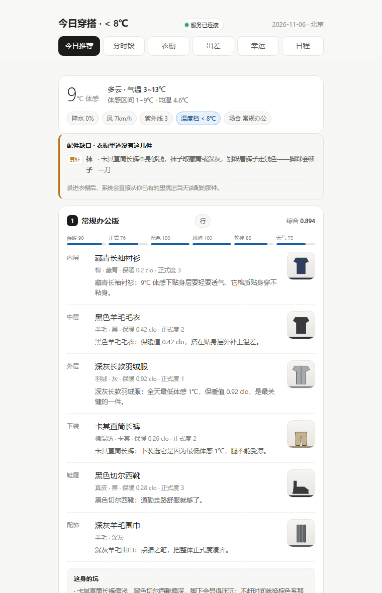

<div align="center">

# dressmate

**拍照建衣橱，按天气和场合给穿搭建议。**

用 19 条可解释的规则代替大模型：零 token 成本，断网也能用，每条建议都讲得清为什么。

[English](README.md) · [简体中文](README.zh-CN.md) · [贡献指南](CONTRIBUTING.md)

</div>

---

<div align="center">



</div>

---

## 它和别的穿搭 App 有什么不一样

大部分穿搭工具的流程是「拍照 → 交给大模型 → 出一段话」。dressmate 反过来：

**每一句建议都来自一条可查、可改、可争论的规则。**

| | 大模型方案 | dressmate |
|---|---|---|
| 一身要多少钱 | 每次调用都烧 token | 零 |
| 断网能用吗 | 不能 | 能 |
| 为什么推荐这件 | 模型自己编的理由 | 指向具体规则和具体单品 |
| 规则能改吗 | 不能 | 改一个数字，全局生效 |
| 换一次模型结果会变吗 | 会 | 不会 |

核心是 12 条风格罚分（`engine/styling.py`）+ 7 条配件校验（`engine/extras.py`），
外加温度曲线、正式度分档、配色协调：

```python
PENALTY = {
    "three_colors": 0.32,           # 一身超过三个色系
    "shoe_jump": 0.20,              # 鞋单独跳一个颜色
    "sneaker_dress_pants": 0.45,    # 运动鞋配西裤
    "sneaker_tailored_outer": 0.35, # 大衣/西装外套配运动鞋
    "shoe_drops_tier": 0.28,        # 鞋掉档：整套正式度被一双鞋拖下来
    "outer_drops_tier": 0.20,       # 外套掉档
    "tone_up_dark": 0.08,           # 正式场合上深下浅
    # ...
}
```

另外 7 条配件校验（`engine/extras.py`）管那些「主体之外」的讲究：

```python
# belt_mismatch   皮带与皮鞋不同色
# sock_contrast   深色西裤配浅袜
# tie_clash       领带与衬衫撞色
# bag_jump        包与整体色系脱节
# skirt_short     裙长与场合不配
# hosiery_gap     正式裙装配了丝袜但颜色不对
# sheer_bottom    下装透光
```

它们不进候选池——皮带只能跟皮鞋、袜子只能跟裤子、领带由衬衫和外层定，
搜这些没有自由度的变量是浪费时间。搭配师的做法本来就是「先定主体，再按主体收口」。
所以这一层做两件事：**反推**该配什么（衣橱里有就挑出来），**校验**配得对不对。

风格分用**乘法**权重进入总分（`score *= 1 - 0.40 * (1 - style)`）。这一点很关键：早先用减法，「运动鞋配西裤」只值 0.03 分，会被保暖细节顶掉；改成乘法之后它才真正压得住。

## 快速开始

### Docker（推荐）

```bash
docker compose up -d
# 打开 http://localhost:8848
```

第一次启动会自动放一份 31 件的**虚构样例衣橱**进去，你打开就能看到推荐长什么样。想换成自己的，在网页里删掉再上传照片即可。

### 本地跑

零第三方依赖，Python 3.9+ 就行：

```bash
python server.py
# 打开 http://127.0.0.1:8848
```

Windows 上也可以双击 `一键启动.bat`。

## 它能做什么

- **拍照建衣橱** — 上传照片，AI 识别品类 / 颜色 / 材质 / 保暖值；不配 AI 也能按中文文件名批量导入（`藏青长袖衬衫.jpg` → 内层 / 衬衫 / 藏青 / clo 0.20 / 正式度 3）
- **按天气推荐** — 内置 323 个地级市离线坐标表，Open-Meteo 天气；断网时按 35 座参照城市的月均气温插值估算（平均误差 3.4℃）
- **按场合推荐** — 通勤 / 正式 / 休闲 / 运动 / 居家，各走不同的正式度目标
- **一天分时段** — 上午开会、下午见客户、晚上健身，三段给三套
- **出差打包** — 选日期范围，算沿途天气和需要带几件
- **配件分级** — 缺皮带和缺眼镜不是一回事：前者这身就不成立，后者只是少层讲究
- **说清楚这身的坑** — 不是「你今天很帅」，而是「卡其裤配黑切尔西靴脚下会压沉，换棕色那双」

## 目录结构

```
engine/          规则引擎（核心）
  styling.py     12 条风格铁律与罚分表
  recommend.py   候选生成、打分、三套去重
  extras.py      配件分级与缺口判定
  city.py        离线城市表 + 在线兜底
  weather.py     天气与体感温度（断网时按气候表插值兜底）
  context.py     场合识别
  timeline.py    时段切分
  paths.py       运行时路径（容器里可挪到卷上）
server.py        HTTP 服务与 API
web/index.html   单文件前端
samples/         公开样例衣橱（虚构）
tools/           导入、校验、发布自检脚本
tests/           286 个测试
```

## 配置

全都有合理默认值，不配也能跑。

| 环境变量 | 作用 | 默认 |
|---|---|---|
| `DRESSMATE_DATA_DIR` | 状态目录（衣橱 / 城市表 / 日程 / 日志） | `./data` |
| `DRESSMATE_PHOTO_DIR` | 照片目录 | `./wardrobe/photos` |
| `DRESSMATE_WARDROBE_PATH` | 衣橱 json | `./wardrobe/wardrobe.json` |
| `DRESSMATE_AI_BASE_URL` | OpenAI 兼容端点 | 无（不启用 AI） |
| `DRESSMATE_AI_API_KEY` | 该端点的 key | 无 |
| `DRESSMATE_AI_MODEL` | 视觉模型名 | `gpt-4o-mini` |
| `DRESSMATE_TOKEN` | 写操作令牌 | 无（不设 = 不校验） |
| `DRESSMATE_ALLOWED_ORIGINS` | 额外允许的 Origin，逗号分隔 | 无 |
| `PORT` | 监听端口 | `8848` |

**接一个自己的视觉模型**（Ollama / vLLM / 任何 OpenAI 兼容服务）：

```yaml
environment:
  DRESSMATE_AI_BASE_URL: http://host.docker.internal:11434/v1
  DRESSMATE_AI_MODEL: qwen2.5vl
```

不配 AI 完全不影响使用——手工录入，或者用文件名批量导入。

## 隐私

照片和衣橱数据**只存在你自己的机器或你自己的卷里**。它会离开本机的路径有三条，都在这里：

| 什么时候 | 什么数据 | 发到哪 |
|---|---|---|
| 每次看推荐 | 经纬度 | Open-Meteo（免费天气服务），不带你任何身份信息 |
| 用了「拍照自动识别」 | **照片本身** | 你配置的视觉模型端点 |
| 填了 `cloud-config.local.js` | **照片本身** | 那个文件里指定的云服务 |

- **默认什么都不发。** 仓库里的 `web/cloud-config.js` 是空模板，不填就没有云端。
- 想接自己的模型，推荐用环境变量（见上面的配置表）——密钥只留在你机器上。
- 如果你填了 `data/cloud-config.local.js`（WorkBuddy 云服务），照片会发到那里。
  这个文件**不会**进版本库，也**不会**被静态服务读到（`web/` 目录下的私有文件一律 404）。
- 紫微斗数「今日幸运穿搭」是可选的娱乐功能，需要 Node.js，默认关闭。
- `docker compose` 默认只绑 `127.0.0.1`，局域网里的别人访问不到。

## 安全

这个服务保存的是私人数据，所以内置了两道防护，**都是默认开着、不用配**。

### CSRF 防护（始终生效）

浏览器发起的跨站 POST 会被拒掉——判断依据是 `Origin`（或 `Referer`）和 `Host` 对不对得上。
这样你开着衣橱页面、同时开着别的网页时，那个网页没法偷偷改你的数据。

命令行调用（`curl`、脚本）不带这两个头，照样放行，所以自托管用户还能用脚本调自己的服务。

放在反向代理后面时，Host 是代理地址、Origin 是真实域名，对不上。用白名单放行：

```bash
DRESSMATE_ALLOWED_ORIGINS=https://你的域名 docker compose up -d
```

### 访问令牌（可选）

设了 `DRESSMATE_TOKEN` 之后，所有写操作（增删改衣橱、改日程）都必须带上这个令牌：

```bash
DRESSMATE_TOKEN=你的密码 docker compose up -d
```

- 浏览器第一次打开会问你令牌，输入后记在这台机器的 localStorage 里，以后不用再输。
- 命令行调用可以放在头里（`X-Dressmate-Token: 你的密码`）或请求体的 `token` 字段里。
- **不设就没有这层校验**，本地单人用最省事——这就是「不配也能跑」的取舍。
- 令牌**不会**出现在页面源码里。否则同一个 WiFi 的人打开首页就能从开发者工具里读到，
  这道防线等于白设。

如果你的服务要暴露给局域网以外的人，令牌只是最基础的一层——请自己套一层 HTTPS 反代，
再加真正的用户体系。

## 跑测试

```bash
python -m unittest discover -s tests -v
```

286 个测试，0.8 秒跑完，不需要联网。

## 常见问题

**Q：它需要大模型吗？**
不需要。推荐全部由 `engine/styling.py` 里的规则算出，不调任何模型。只有「拍照自动识别品类」这一步需要视觉模型，而且它是可选的。

**Q：我的衣服照片会上传到哪？**
只到你自己的机器或你自己的 Docker 卷。天气查询只发经纬度给 Open-Meteo。只有你主动配置了 `DRESSMATE_AI_BASE_URL` 时，照片才会发给你指定的那个端点。

**Q：为什么不用向量检索 / 大模型推荐？**
向量检索解决的是「哪件衣服和这件搭」，但穿搭真正的难点是「这身为什么不成立」——运动鞋配西裤在语义上很搭，但就是不对。规则引擎能把这类「直觉」写成可查、可调、可争论的条目，而且每次跑的结果一致。代价是规则要有人维护——这也是这个仓库最需要你的地方。

**Q：能加自己的规则吗？**
能。`engine/styling.py` 的 `PENALTY` 表就是规则表，加一条、改一个权重，全局生效。

**Q：Docker 里数据存在哪？**
`./data` 目录（compose 里挂成卷）。删容器不丢数据。`docker compose down -v` 才会清空。

**Q：中文文件名导入怎么用？**
把照片按中文命名放进 `wardrobe/photos/`，比如 `藏青长袖衬衫.jpg`，然后：

```bash
python tools/import_photos.py --export-csv   # 先导出看推断结果
python tools/import_photos.py --commit       # 确认没问题再写入
```

推断出来的 `clo`（保暖值）和 `formality`（正式度）建议人工核对——这两个字段直接决定推荐质量。

## 许可

[AGPL-3.0-only](LICENSE)。可以自托管、可以改、可以商用；改了要开源，网络提供服务也要开源。

## 贡献

这个项目最缺的不是代码，是**真实的衣橱样本**。尤其是女装 —— 引擎的女装铁律已经写好了，但因为大部分测试数据是男装，它一直没机会被真正验证。

如果你愿意贡献，看 [CONTRIBUTING.md](CONTRIBUTING.md)。

想在自己机器上部署一份，看 [docs/PUBLISH.md](docs/PUBLISH.md)。
